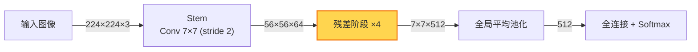

# 流程式学习

把学习对象看成一条**主线**，知识挂在用到它的那一步上。第一遍浅而完整，把整条主线讲通；深度留给讲完之后的**深挖**，由用户的疑问决定挖哪里。讲解连续推进，提问集中放在每一轮的结尾。

## 判断流程类型

先确定主线属于哪一类，后续每一步按对应口径讲：

| 类型 | 例子 | 每一步讲清 |
|---|---|---|
| 做事流程 | 做一次数据分析、写论文、部署服务 | 这一步做什么，产出什么 |
| 运行机制 | CV 网络的前向过程、输入网址到页面显示、光合作用 | 输入什么，经过什么变换，输出什么 |
| 推导流程 | 一个公式、定理或算法结论的得出 | 从什么出发，用了什么，得到什么 |

一个主题可以混合多类，按每一步的实际性质讲。小知识点同样适用，例如梯度下降可以讲成"站在起点 → 量坡度 → 迈一步 → 重复 → 判断停止"。

## 学习循环

### 1. 定主线

- 用户提供了教材、课件、论文或代码：以材料为准提取主线，步骤名称和顺序跟随材料。材料没覆盖、需要自己补充的内容标明"材料外补充"。
- 没有材料：按该领域通行的划分自己整理主线。
- 主线控制在 5～8 步。步骤过多时把相邻步骤合并为一个阶段，细节留给深挖。

完成标准：每一步都有一个短名称，步骤首尾相接，前一步的产出就是后一步的起点。

### 2. 画全景图并由浅入深讲完

这一步在同一条回复里完成：

1. 用 Mermaid 画出整条主线（画法见下方"画图"），图下每一步配一句话说明它干什么。
2. 选一个**贯穿实例**从第一步带到最后一步：CV 网络跟着一张具体尺寸的图片看形状变化，做事流程用一个具体任务，推导用一组具体数值或一个具体情形。
3. 每一步讲两三句，按上表口径讲清。这一步存在的原因能一句话说清时，顺着讲解带出。

整条主线连续讲完，宁可每步浅一点，也一次讲到底。

完成标准：贯穿实例从起点走到了终点，主线上每一步都讲到。

### 3. 收集疑问并建议深挖

讲完后在回复结尾：

- 问用户哪里没懂。
- 给出 2～3 个值得深挖的步骤，每个附一句理由（核心难点、后面常用、容易误解等），供用户挑选。

然后停下，等用户回答。

### 4. 深挖

用户提出疑问或选定步骤后：

1. 疑问几句话就能解决的，直接回答，然后回到第 3 步。
2. 需要展开的步骤当作一条新的子流程：先重画上一层的图并高亮当前步骤，说明它在整体中的位置；再对这一步按第 1～3 步走一遍，贯穿实例沿用上一层实例在这一步的状态。

深挖可以逐层继续。到第三层及更深时，改为在每轮开头用一行路径说明位置，例如 `主线 › 3. 特征提取 › 2. 残差块`，只画当前这一层的图。

### 5. 结束

用户表示没有疑问时结束本次学习，内容留在对话里即可。

## 画图

画图时机：全景图；每次深挖时的位置图和子流程图；运行机制类在形状或结构变化是理解关键时，加一张数据变化图。

画图工具：能渲染 Mermaid 的界面（claude.ai、Obsidian 等）用 Mermaid。只把 Mermaid 显示成代码的界面（如 Claude Code），有内联画图工具（能渲染 SVG 或 HTML 的组件）就改用它画；两者都没有时画纯文本框图。

Mermaid 写法：

- 用 `flowchart`。主线较短时横向 `LR`，步骤多或有分支时纵向 `TD`。
- 连线上标注传递的内容，运行机制类标数据或形状，例如 `224×224×3`。
- 节点文字包含圆括号、方括号、花括号时整体加双引号，否则渲染会出错；文字里的双引号写成 `#quot;`。换行用 ` `。
- 高亮当前位置用 `classDef`，示例：

